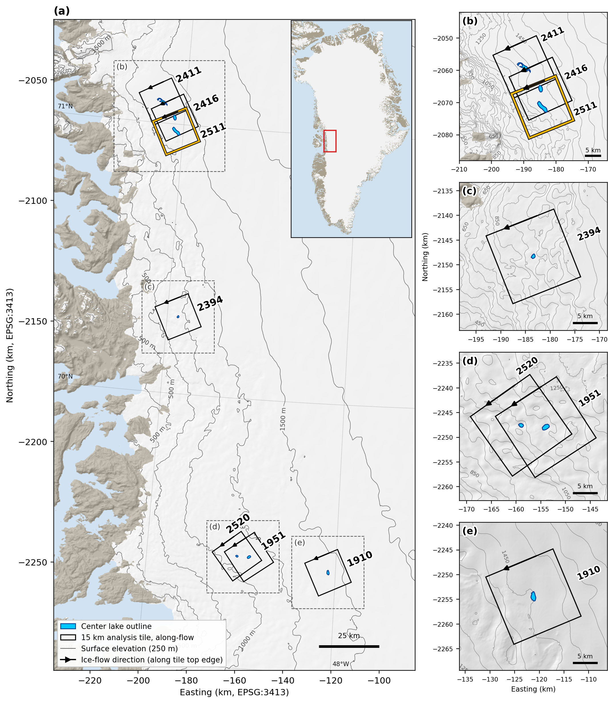

# pnas2026-solverfiles

Elmer/Ice solver input files for:

> Lai, C.-Y., Rines, J. H., Coffey, N. B., Lee, E., Clerc, F., Hilditch, J. P.,
> Gagliardini, O., & Stevens, L. A. (2026). *From blistering to sliding:
> Ice-sheet stress perturbations from water injection to the bed.* PNAS.

These are the solver input files (`.sif`) used for the full-Stokes
Elmer/Ice simulations in the paper: viscous (free-slip slippery patch) and
elastic (pressurized subglacial blister) stress-perturbation simulations of
seven supraglacial-lake tiles on real Greenland topography — ice surface and
bed from [BedMachine Greenland Version 5](https://doi.org/10.5067/GMEVBWFLWA7X)
(Morlighem et al., NSIDC) — (lakes 1910, 1951,
2394, 2411, 2416, 2511, 2520 in the naming of the
[Dunmire et al. 2025](https://doi.org/10.1029/2024EA003793) lake catalog,
whose data and code are archived on Zenodo at
[10.5281/zenodo.14587026](https://doi.org/10.5281/zenodo.14587026)),
plus the idealized-slab simulations from the SI.

Each simulation directory is self-contained and ready to run: the `.sif`, the
mesh (`.geo` source and `.msh`), and the DEM / auxiliary inputs that
simulation needs. See **Running the simulations** below for the complete
zero-to-run commands.

## Layout

```
elmer-ice/
├── real_topography/
│   ├── viscous/lakeNNNN/            # Glen free-slip-patch sim per lake: SIF, mesh,
│   │   │                            #   DEMs (bed/surface/speed), PROG/ user function
│   │   └── lake2394/resolution_convergence/   # coarse/mid/fine mesh runs (SI)
│   └── elastic/lakeNNNN/            # reference + calibrated-blister SIFs, mesh, DEMs
│       └── lake2394/patch_experiments_E9GPa/  # basal-sliding sweep (SI)
└── idealized_slab/                  # 26 Newtonian flat-slab sims (published Fig. 3)
```

Lake directories use the paper's lake IDs; [MANIFEST.md](MANIFEST.md) maps
them to the internal IDs in the filenames, lists the calibrated per-lake
parameters, and records which figure every simulation appears in.
`figs/` holds figure-generation scripts.


*The seven center-lake tiles. Gold: lake 2511, used as the featured example
below.*

## The simulations

- **Viscous (real topography)** — full-Stokes, Glen rheology, SICOPOLIS
  temperature profile. Each lake tile runs pre-drainage (no patch) and
  post-drainage (circular free-slip patch, R = 2.5 km, under the drained
  lake); basal friction c_b is calibrated per lake to observed speed.
- **Elastic (real topography)** — linear elasticity on the same tiles.
  Post-drainage is a pressurized subglacial blister (bed-uplift DEM at the
  calibrated water pressure); the stress perturbation is blister minus
  undisturbed reference.
- **Idealized** — Newtonian flat slabs with a circular free-slip patch,
  validating the paper's analytical solution (Fig. 3).
  <!-- interactive explorer link goes here once deployed -->

## Running the simulations

All you need is [Docker](https://docs.docker.com/get-docker/); the
`andrewdnolan/elmerice` image contains the full Elmer v9.0 + Elmer/Ice stack
(ElmerGrid, ElmerSolver, the Elmer/Ice solver and user-function libraries,
MUMPS, Lua). Outputs are VTU files written into the mesh directory — view
them in [ParaView](https://www.paraview.org/).

### Quickstart: a laptop-sized worked example

Idealized Newtonian slab, H = 1000 m, surface slope 0.5°, free-slip patch
R = 2500 m — one of the simulations in Fig. 3D. Runs in well under an hour
on an ordinary laptop:

```bash
git clone https://github.com/YaoGroup/pnas2026-solverfiles.git
cd pnas2026-solverfiles/elmer-ice/idealized_slab
docker pull andrewdnolan/elmerice

# 1) convert the gmsh mesh to an Elmer mesh database (creates flatslabnewt_R2500/)
docker run --rm -v "$PWD":/work -w /work andrewdnolan/elmerice \
  ElmerGrid 14 2 flatslabnewt_R2500.msh -autoclean

# 2) run the solver
docker run --rm -v "$PWD":/work -w /work andrewdnolan/elmerice \
  ElmerSolver flatslabnewt_R2500_H1000_a05_G01_periodicBC.sif

# 3) result: flatslabnewt_R2500/flatslabnewt_R2500_H1000_a05_G01_periodicBC_t0001.vtu
```

Every other simulation follows the same mesh-then-solve pattern; only the
compute requirements differ (see the table below).

### Real topography, viscous (Glen rheology)

Each `real_topography/viscous/lakeNNNN/` directory is self-contained. The
temperature user function is compiled once per directory, and the SIF as
shipped runs the no-patch (pre-drainage) case; two header variables switch
it to the post-drainage free-slip-patch case:

```bash
cd elmer-ice/real_topography/viscous/lake2511
docker run --rm -v "$PWD":/work -w /work andrewdnolan/elmerice \
  bash -lc "elmerf90 PROG/USF_TAVz.F90 -o PROG/USF_TAVz && \
            ElmerGrid 14 2 lake2511_d25km_r2500m.msh -autoclean && \
            ElmerSolver lake2511_glen_d25km_r2500m_tsic_base.sif"   # no-patch case
```

For the patch case, edit the SIF header — `patch_nopatch_str = "patch"` and
`R = 2500` — and run `ElmerSolver` again.

### Real topography, elastic

One SIF per case — the undisturbed reference (`*_nopatch_u0p0*.sif`) and the
pressurized blister (`*_blister_u0p0_Pw*.sif`) — with the same
mesh-then-solve pattern and no user-function compilation.

## Software versions

- **Elmer/Ice: Elmer v 9.0 (Rev: cf291b69, compiled 2021-11-03)**, with MUMPS
  and the Lua interpreter linked in.
- Production runs used the Docker image
  [`andrewdnolan/elmerice`](https://hub.docker.com/r/andrewdnolan/elmerice)
  (`docker pull andrewdnolan/elmerice`).

## Computational requirements

Every simulation here runs **serially** (a single MPI task with one thread;
the direct MUMPS solver dominates the runtime). Wall times below are measured
from the production run logs on a Google Cloud `n1-highmem-64` instance.

| Category | Mesh size | Wall time per solve | Memory |
|---|---|---|---|
| Real topography, viscous | ~46.8k-node footprint × 20 levels (~0.9 M nodes) | ~6–25 h | large — see note |
| Real topography, elastic | same mesh | ~12–16 h | large — see note |
| Idealized slab | ~1k-node footprint × 30 levels | minutes to ~1.7 h | laptop-friendly |

**Memory note:** the production runs were limited to 4 simultaneous solves on
a 416 GB instance by memory; budget on the order of 100 GB RAM per
real-topography solve. The idealized-slab cases run comfortably on an
ordinary workstation or laptop.

## More on Elmer/Ice

- Elmer/Ice project site, wiki, and course tutorials: <http://elmerice.elmerfem.org>
- Elmer source code (includes the Elmer/Ice solvers): <https://github.com/ElmerCSC/elmerfem>
- Elmer documentation: <https://www.elmerfem.org>

## Status

Under construction — contents are being assembled and verified against the
production run inputs. Do not use until this notice is removed.
